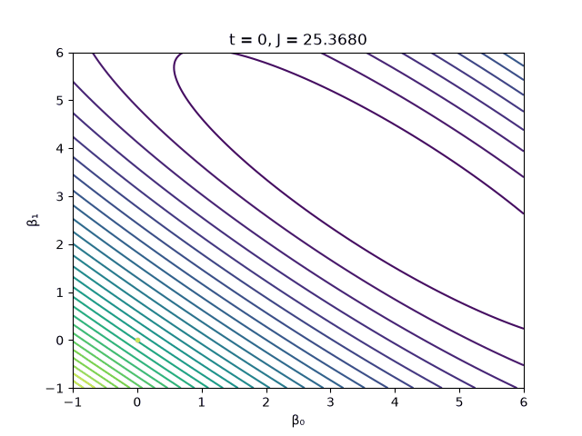

# Aula 6.3 — Gradiente descendente

Em vez de resolver a equação normal de uma vez, o gradiente descendente **chega aos coeficientes passo a passo**: calcula para onde o custo aumenta (o gradiente) e anda no sentido contrário, com passos de tamanho α.

## Conteúdos

- Custo J(β) = ‖Xβ − y‖² / 2m
- Regra de atualização: β ← β − α · ∇J
- Taxa de aprendizado (α), épocas e critério de parada (tolerância)
- Curvas de nível do custo e animação da trajetória com `FuncAnimation`

## Desafio de casa: classe `GradienteDescendente`

`GradienteDescendente(alpha=0.1, epocas=1000, tol=1e-8)` com `fit`, `predict` e `score` (R²), guardando o histórico do custo e a trajetória de β.

**Resultados** (100 pontos gerados com y = 4 + 3x + ruído):

| Item | Resultado |
|---|---|
| β encontrado | (3,97; 3,02), igual à solução exata do `pinv` |
| Custo | caiu de 25,37 para 0,12 |
| Épocas | 431 (parou pela tolerância) |
| R² | 0,92 |

## Arquivos

| Arquivo | O que faz |
|---|---|
| `exercicio_guiado.py` | versões com laço e vetorizada, curvas de nível e superfície 3D do custo |
| `desafio.py` | classe `GradienteDescendente`, gráficos e animação |
| `descida.gif` | animação gerada pelo desafio |

---

**← Anterior:** [Aula 6.2](../Aula6.2/README.md) · **Voltar:** [Aula 6](../README.md) · **Próxima →** [Aula 6.4](../Aula6.4/README.md)
